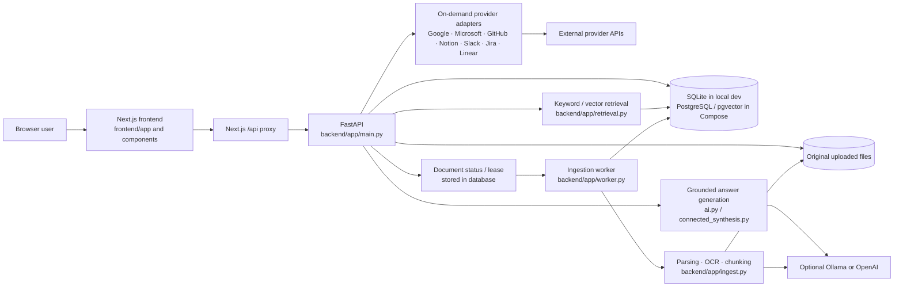
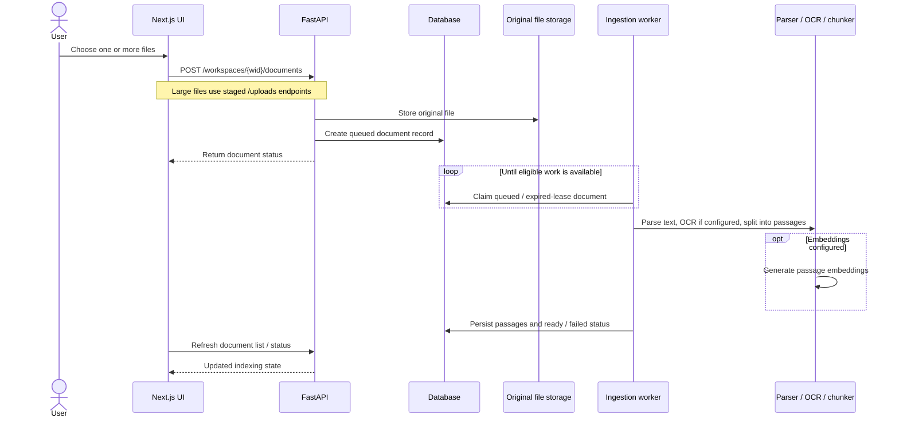
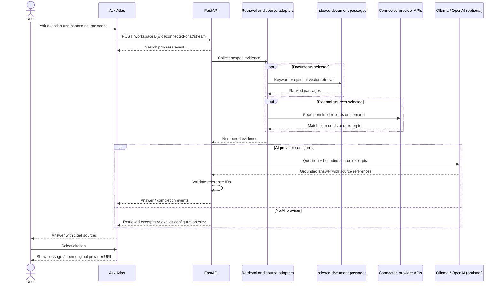

# Atlas — Document intelligence

Atlas is a private, workspace-based research app. Upload documents, connect read-only data sources, ask questions across selected sources, and inspect citations that link back to the evidence.

The app uses a Next.js/TypeScript frontend and a FastAPI backend. Local development uses SQLite; Docker Compose runs PostgreSQL with pgvector. You can generate answers with Ollama on your machine, OpenAI, or use source excerpts without an AI provider.

## Architecture and request flows

The diagrams below describe the code in this repository, rather than a proposed architecture. GitHub renders them directly with Mermaid.

### System architecture



In local development the API and worker can run in the same environment; Compose runs separate API and worker services. The worker claims document records from the database rather than consuming messages from a separate queue broker. Connector records are fetched on demand, not automatically ingested into the document library.

### Code flow: upload and index a document



The worker renews leases during processing and can retry transient failures. Search uses only documents marked ready.

### Code flow: ask a question and inspect evidence



For documents-only requests, the server may use the document answer-generation path rather than cross-source synthesis. Source IDs are checked, but a valid ID is **not proof** that every claim is supported by its citation. If the model cannot produce a valid answer, clients should show an explicit failure instead of inventing conclusions.

### Where to follow the code

| Workflow | Entry point | Key modules |
| --- | --- | --- |
| Frontend workspace | `frontend/app/page.tsx` | `components/AtlasWorkspace.tsx`, `components/chat/`, `components/documents/` |
| Upload and background indexing | `backend/app/main.py` document/upload routes | `worker.py`, `ingest.py`, `db.py` |
| Document retrieval | `backend/app/main.py` chat routes | `retrieval.py`, `ai.py` |
| Cross-source answers | `backend/app/main.py` connected-chat routes | `external_sources.py`, `gmail.py`, `drive.py`, `connected_synthesis.py` |
| Citation display | `frontend/components/chat/ResearchAnswer.tsx` | `frontend/lib/evidence.ts` |

## Get started locally

### Requirements

- macOS or Linux (the staged-upload implementation uses filesystem locks)
- Python 3.9 or later
- Node.js 20.9 or later and npm
- Tesseract OCR for scanned PDFs (optional; Docker installs it for you)
- Ollama for local AI (optional), or an OpenAI API key

### Install and start

Run these commands from the repository root:

```sh
cp .env.example .env
python3 -m venv .venv
.venv/bin/pip install -r backend/requirements-dev.txt
```

Generate an encryption key for connected-source credentials:

```sh
.venv/bin/python -c "from cryptography.fernet import Fernet; print(Fernet.generate_key().decode())"
```

Copy the printed value into `.env` as `GMAIL_TOKEN_ENCRYPTION_KEY=...`. This key is required for encrypted connected-source credentials. Keep it private and back it up: Atlas cannot decrypt saved credentials if the key is lost or changed.

Start the API in one terminal:

```sh
PYTHONPATH=backend .venv/bin/uvicorn app.main:app --host 127.0.0.1 --port 8000
```

Start the frontend in a second terminal:

```sh
cd frontend
npm ci
npm run dev
```

Open <http://localhost:3000>, create an account, and use the default workspace or create another. The API docs are at <http://127.0.0.1:8000/docs>.

For scanned PDFs, install Tesseract locally (`brew install tesseract` on macOS or `sudo apt-get install tesseract-ocr` on Debian/Ubuntu). To turn OCR off and accept searchable PDFs only, set `OCR_ENABLED=false` in `.env`.

To try document search, upload the examples in `samples/` and ask a question such as “What budgets were proposed?” The sample documents intentionally disagree about dates and budgets.

SQLite data and uploaded files are stored under `data/` by default. The directory is excluded from Git. Back it up if you need to preserve a local workspace.

## Choose how Atlas generates answers

The `.env.example` file defaults to `AI_PROVIDER=openai` with an empty API key. In that configuration, Atlas still searches sources and shows matching excerpts, but does not synthesize answers.

### Local AI with Ollama

1. Install [Ollama](https://ollama.com/download).
2. Download the chat and embedding models:

   ```sh
   ollama pull qwen3:4b
   ollama pull nomic-embed-text
   ```

3. Set these values in `.env`:

   ```dotenv
   AI_PROVIDER=ollama
   OLLAMA_URL=http://127.0.0.1:11434
   OLLAMA_CHAT_MODEL=qwen3:4b
   OLLAMA_EMBED_MODEL=nomic-embed-text
   ```

4. Restart the API.

Ollama keeps prompts and generated answers on the machine running Ollama. Atlas does not set an output-token cap for local generation; response time depends on your hardware, and the model still has a finite context window. New uploads use local embeddings. To re-embed existing documents, stop the API worker and run from the repository root:

```sh
PYTHONPATH=backend .venv/bin/python evals/reindex_local.py
```

### OpenAI

Set `AI_PROVIDER=openai` and `OPENAI_API_KEY` in `.env`, then restart the API. Optionally set `CHAT_MODEL` and `EMBED_MODEL`; the defaults are `gpt-4.1-mini` and `text-embedding-3-small`.

With OpenAI selected, document passages and selected connected-source excerpts are sent to the configured OpenAI API for embeddings or answer generation. Responses use `store=False`; that does not promise zero provider-side retention. Only send content you are authorized to process with that provider.

### Search without generated answers

Set `AI_PROVIDER=none` and leave `OPENAI_API_KEY` empty. Atlas returns matching source excerpts instead of a synthesized answer.

## Connect data sources

Google Calendar, OneDrive, Outlook and SharePoint OAuth setup is described in [Connected source setup](docs/FIVE_SOURCE_CONNECTORS.md). Their integrations remain read-only, and live consent flows require provider configuration.


Connections are workspace-scoped and retrieved on demand. Connect a provider in **Sources**, then select it above the prompt in **Ask Atlas**. Source data is not automatically copied into the document library. Disconnecting removes Atlas's saved credential; revoke the token or app authorization at the provider as well when appropriate.

Atlas encrypts saved provider credentials with `GMAIL_TOKEN_ENCRYPTION_KEY`. Do not commit `.env`, share credentials, or paste a bot token where a user token is required.

### Gmail

1. In [Google Cloud Console](https://console.cloud.google.com/), create or choose a project, enable the **Gmail API**, configure the OAuth consent screen, and create an OAuth client of type **Web application**.
2. Add this Authorized redirect URI for local development:

   ```text
   http://localhost:3000/api/gmail/callback
   ```

3. Add the client ID and secret to `.env`:

   ```dotenv
   GOOGLE_CLIENT_ID=your-client-id
   GOOGLE_CLIENT_SECRET=your-client-secret
   GOOGLE_REDIRECT_URI=http://localhost:3000/api/gmail/callback
   ```

4. Make sure `GMAIL_TOKEN_ENCRYPTION_KEY` is set, restart the API and frontend, then open **Sources → Gmail → Connect Gmail** and authorize read-only access.

Gmail search is opt-in per Ask Atlas question. Email is fetched on demand, not indexed automatically. The connector uses the restricted `gmail.readonly` scope; public deployments may need Google's verification and security assessment. Review Google's current requirements before publishing.

### Google Drive

Use the same Google Cloud project and OAuth Web application as Gmail. Enable the **Google Drive API** and add this additional Authorized redirect URI:

```text
http://localhost:3000/api/drive/callback
```

Set the Drive redirect in `.env` and restart:

```dotenv
GOOGLE_DRIVE_REDIRECT_URI=http://localhost:3000/api/drive/callback
```

Connect from **Sources → Google Drive**. Atlas uses read-only Drive access and reads files on demand. It can extract text from Google Docs, Sheets (CSV), PDF, DOCX, and supported text files. Slides and image-only Drive PDFs are not supported as Drive evidence. Drive access uses the restricted `drive.readonly` scope; review Google's verification and security-assessment requirements before public launch.

### GitHub

Create a fine-grained personal access token scoped to the repositories Atlas should access, with read-only metadata and issue permissions. Add it under **Sources → GitHub**.

Atlas can search repositories, issues, and pull requests. Repository descriptions and metadata can support project overviews. The connector does not search source-code files. Results are limited to repositories and records visible to the token.

### Notion

Create an internal integration in [Notion My integrations](https://www.notion.so/profile/integrations), copy its secret, and share the pages or parent pages you want Atlas to read with that integration. Add the token under **Sources → Notion**.

Notion integrations only see pages shared with them. Atlas searches accessible page titles and reads page blocks on demand; a valid token does not grant automatic access to every workspace page.

### Slack

Slack message search requires a **user-scoped OAuth token** with the `search:read` user token scope. Bot tokens may authenticate but cannot use message search.

1. Create or open the Atlas app in the [Slack API console](https://api.slack.com/apps).
2. Under **OAuth & Permissions → User Token Scopes**, add `search:read`.
3. Reinstall the app to the intended workspace and authorize the requested access.
4. Copy the **User OAuth Token** (not the Bot User OAuth Token) and add it under **Sources → Slack**.

The user token can search content that the authorizing Slack user can access. Slack may require you to reauthorize Atlas after changing scopes.

## Run with Docker Compose

Docker Compose runs PostgreSQL/pgvector, the API, a separate background worker, and the frontend. From the repository root:

```sh
cp .env.example .env
```

Set `POSTGRES_PASSWORD` to a strong value in `.env`. Set `GMAIL_TOKEN_ENCRYPTION_KEY` if you will connect sources. Add an AI provider configuration if you want generated answers, and add the Google OAuth values if using Gmail or Drive. Then run:

```sh
docker compose up --build
```

Open <http://localhost:3000>. The database and documents use named volumes. The web port is bound to loopback. Compose runs Ollama on the host by default only if you configure:

```dotenv
AI_PROVIDER=ollama
OLLAMA_URL=http://host.docker.internal:11434
```

Pull the models on the host before connecting. `host.docker.internal` lets the API container reach Ollama on macOS/Windows; on Linux, configure a host-gateway route or use another reachable Ollama URL.

The default Compose PostgreSQL password is for local development only. Changing `POSTGRES_PASSWORD` after PostgreSQL has initialized does not change the existing database user's password; recreate or update the database credentials deliberately. Do not expose this development stack directly to the public internet.

## Troubleshooting

- **Atlas only shows excerpts, not an answer:** Check `AI_PROVIDER`, the API logs, and that Ollama is running or the OpenAI key is valid. Restart the API after changing `.env`.
- **Ollama is unreachable in Docker:** `127.0.0.1` inside a container refers to that container. Use `http://host.docker.internal:11434` on macOS/Windows or a host-reachable address on Linux.
- **A saved connection cannot be decrypted:** `GMAIL_TOKEN_ENCRYPTION_KEY` changed or is missing. Restore the original key; otherwise reconnect each provider. Back up the key with the database.
- **Google OAuth returns a redirect error:** The callback URL must match the URI registered in Google Cloud exactly, including scheme, host, port, and path.
- **Google OAuth says access is blocked:** In OAuth consent-screen testing mode, add the account as a test user. Check that the required Gmail or Drive API is enabled and review verification status.
- **Slack says token type is not allowed:** Reconnect with the User OAuth Token after adding `search:read` and reinstalling the app.
- **Notion search returns no pages:** Confirm Atlas was shared with the page or a parent page. The token alone cannot see unshared content.
- **Scanned PDF has no text:** Install Tesseract OCR. Set `OCR_ENABLED=false` only when you want to require searchable PDFs.
- **A model change produces poor document search:** Re-embed existing documents after changing embedding providers or models.

## Development and validation

Run backend tests and frontend checks from the repository root:

```sh
PYTHONPATH=backend .venv/bin/pytest backend/tests -q
cd frontend
npm run typecheck
npm run build
```

The tests use an isolated temporary database and mock provider calls. They do not verify OAuth credentials or live access to Gmail, Drive, GitHub, Notion, or Slack.

For browser tests, install Playwright and Chromium:

```sh
cd frontend
npm install --no-save @playwright/test@1.56.1
npx playwright install chromium
npx playwright test
```

## What Atlas supports

- Workspace accounts, private documents, saved conversations, and source citations.
- PDF, DOCX, TXT, Markdown, CSV, JSON, and HTML ingestion. Individual files can be up to 250 MB; scanned PDF text extraction uses Tesseract OCR.
- Durable document processing with retry and reindex controls.
- Keyword search, optional vector search, and source-grounded answers.
- On-demand Gmail, Drive, GitHub, Notion, and Slack retrieval when each source is connected.

Connected sources use permission checks at the provider and do not sync in the background. AI answers can miss details; review cited passages before relying on them. Atlas validates citation references but does not prove every claim is supported by its citation.

## Security and deployment notes

This project is a development release, not a hardened public service. Before serving other users, add HTTPS and set `COOKIE_SECURE=true`, configure a protected secret store, restrict database/network access, validate backup and restore, and implement rate limits, audit logging, and document parsing isolation. Review provider verification and privacy requirements for the scopes you enable. Do not deploy the sample Compose password or expose the development stack publicly.

Tokens and originals are workspace data. Protect the database, document volume, `.env`, and encryption-key backup as one set. Revoking a token at the provider is separate from disconnecting it in Atlas.

## Project layout

- `backend/app/main.py`: API, authentication, access checks, uploads, chat, and conversations.
- `backend/app/ingest.py`: file parsing, OCR, and chunking.
- `backend/app/retrieval.py`: keyword/vector retrieval and ranking.
- `backend/app/ai.py`: embeddings and grounded answer generation.
- `backend/app/external_sources.py`: GitHub, Notion, and Slack adapters.
- `backend/app/drive.py` and `backend/app/gmail.py`: Google connectors.
- `backend/app/worker.py`: durable ingestion queue worker.
- `frontend/app/page.tsx`: lightweight Next.js entry point.
- `frontend/components/AtlasWorkspace.tsx`: workspace orchestration and API actions.
- `frontend/components/{home,documents,chat,sources,auth,layout,ui}/`: feature-level UI and shared components.
- `frontend/hooks/`: theme, conversation, Gmail and connected-source state.
- `frontend/app/rebuild.css`: current feature-specific visual refinements; consolidation with legacy `globals.css` remains future cleanup.
- `compose.yaml`: PostgreSQL, API, worker, and web services.

## Design preview

Open [the interactive Atlas design preview](docs/Atlas_Research_Workspace.html) locally. It uses fictional sample content and does not connect to the backend; `frontend/app/` is the working interface.
